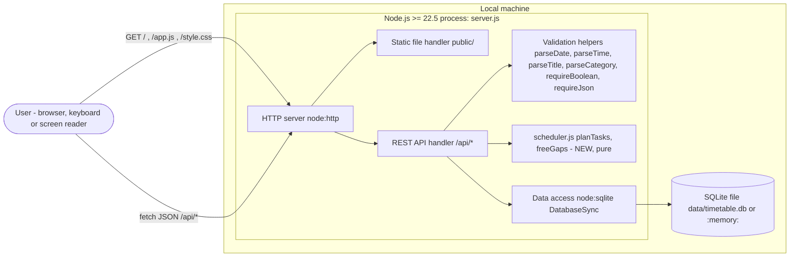
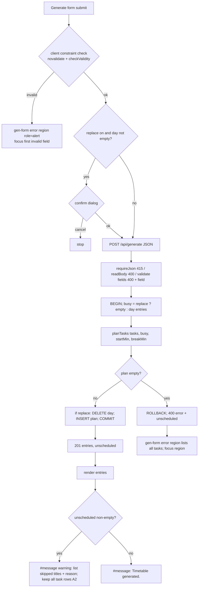
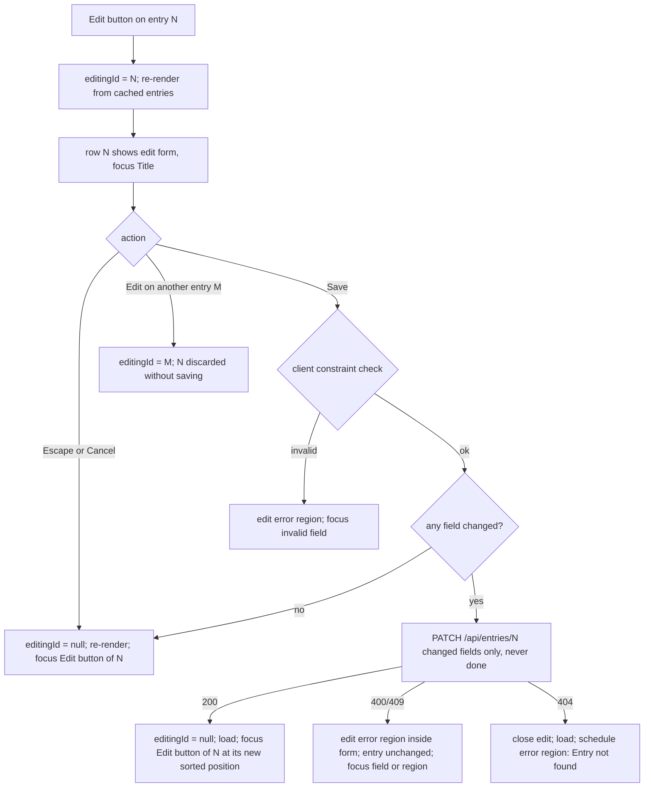
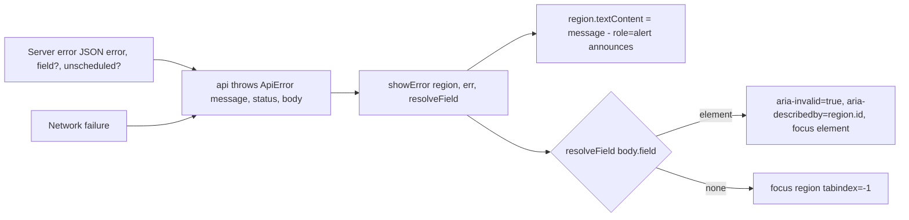

# Architecture: Day planner iteration 1 (Epic TIME-2)

Phase: 3 (design). Status: draft for human approval.
Inputs: `docs/plan/implementation-plan.md` (approved), `docs/analysis.md` (approved), `docs/requirements.md`, source in `timetable-app/`.
Scope: TIME-14 (US-12/G11), TIME-5 (US-03), TIME-4 (US-02), TIME-3 (US-01), TIME-12 (US-10).
Confluence: pending sync (no Confluence MCP tool available to this agent).

Companion documents: `high-level-design.md` (modules, API contract), `low-level-design.md` (functions, algorithm, DOM, CSS), `wireframes.md` (screens and states).

## 1. Context

Single-user, local web app. One Node.js process serves both the static frontend and a JSON REST API and stores data in one SQLite file. No authentication (out of scope, requirements section 6).

## 2. Components and what changes

| Component | File(s) | Today | Change in this iteration | Story |
|---|---|---|---|---|
| HTTP server | `server.js` (bottom) | `server.listen(PORT)` on all interfaces; `decodeURIComponent` can throw -> 500 | Bad URL escape -> 400. Recommendation Q1: listen on `HOST` (default `127.0.0.1`) | TIME-14 |
| Error handling | `server.js` `HttpError`, catch block | `{error}` only | `HttpError(status, message, extra)`; body `{error, ...extra}`; `extra` carries optional `field` and, for generate, `unscheduled` | TIME-14, TIME-5, TIME-12 |
| Validation | `server.js` helpers | `Date.parse` accepts 2030-02-31; `24:00` always rejected; truthy booleans; no Content-Type check; `tasks:[null]` -> 500 | Real calendar check; `24:00` allowed as end only; strict booleans; 415 without JSON Content-Type; per-task object check | TIME-14 |
| Entries API | `server.js` `createEntry`, `updateEntry` | as is | uses new validators (end may be 24:00, `done` must be boolean) | TIME-14, TIME-3 |
| Generator | `server.js` `generateTimetable` + NEW `scheduler.js` | back-to-back from start; throws on first overflow; 409 on any clash when replace off | skip-and-continue; first-fit gap placement around existing entries when replace off; response `{entries, unscheduled}`; 400 with task list when nothing fits | TIME-5, TIME-4 |
| SQLite | `entries` table | unchanged | **No schema change** (see section 5) | all |
| Frontend markup | `public/index.html` | one global `#message` (role=status) used for errors and success | one error region (`role="alert"`) per form plus one for the schedule; `#message` keeps success and warning notices; forms get `novalidate` | TIME-12, TIME-5 |
| Frontend logic | `public/app.js` | render with checkbox and Delete; `run()` shows every error in `#message` | Edit button + inline edit form (one at a time); `ApiError` with status/field; per-form error display with `aria-invalid` and focus management; generate shows skipped tasks | TIME-3, TIME-5, TIME-12 |
| Styles | `public/style.css` | no focus style; 3 category colours and `--danger` below AA; `opacity:0.7` on done entries | `:focus-visible` ring; AA-safe colours; invalid-field and error-region styles; edit-mode layout | TIME-12, TIME-3 |
| Tests | `test/api.test.js`, NEW `test/scheduler.test.js` | API tests only | extended API tests; pure unit tests for `planTasks` (picked up automatically by `node --test test/`) | TIME-14, TIME-5, TIME-4 |

## 3. Data flows for the changed flows

### 3.1 Generate (TIME-5, TIME-4)

### 3.2 Edit an entry (TIME-3)

### 3.3 Error display (TIME-12)

Region ownership: add form -> `#add-error`; generate form -> `#gen-error`; edit form -> `#edit-error-<id>`; toggle done, delete, clear day, day load -> `#schedule-error`. `#message` (role=status) is used only for success and the skipped-tasks warning.

## 4. Technology choices and constraints

| Topic | Choice | Reason |
|---|---|---|
| Runtime | Node.js >= 22.5, ES modules (unchanged) | `node:sqlite` requires 22.5; `package.json` engines already set |
| Persistence | `node:sqlite` `DatabaseSync` (unchanged) | synchronous API keeps the generate transaction simple and free of interleaving |
| Dependencies | none added; no build step; vanilla JS/CSS | requirements section 7 and plan quality gate "no new dependencies" |
| Tests | `node:test` (unchanged); new pure unit test file for the scheduler | runs with `npm test`, no install; Playwright not used (D8) |
| New file | `timetable-app/scheduler.js` (Recommendation Q4, see HLD section 6) | only deviation from the existing structure; justified by risk R2 |
| Security | output via `textContent` only (keep); 415 on non-JSON POST/PATCH; Recommendation Q1 bind `127.0.0.1` | no XSS surface added; reduces CSRF and LAN exposure |
| Accessibility | WCAG 2.1 AA targets: 1.4.3 text contrast 4.5:1, 1.4.11 non-text 3:1, 2.4.7 focus visible, 3.3.1 error identification, 4.1.3 status messages | TIME-12 acceptance criteria |

## 5. Data model

No database schema change, no migration. Confirmed against `server.js`:

- `entries(id, date TEXT, title TEXT, start_min INTEGER, end_min INTEGER, category TEXT, done INTEGER)` already stores `end_min = 1440` (generation produced 24:00 ends before this change); `fmt(1440)` prints `24:00`.
- Entry DTO is unchanged: `{id, date, title, start, end, category, done}`.
- API-level changes only: `POST /api/generate` response shape (breaking, D1) and the error body (additive `field`, `unscheduled`). Existing DB files stay compatible in both directions (plan rollback section).

## 6. Recommendations for human confirmation

These are not decided by this design. Each is labelled Recommendation and listed with the default the developer will follow if you approve the design without comment.

| ID | Question | Recommendation | Default if approved as-is |
|---|---|---|---|
| Q1 | Bind to 127.0.0.1? | Recommendation: yes. `HOST` env var, default `127.0.0.1`, added as WI-14 under TIME-14 (0.5 h). Also change the test `BASE` to `http://127.0.0.1:3999` because Node may resolve `localhost` to `::1` first and the IPv4-only listener would then refuse the connection. | Implement WI-14 |
| Q2 | Re-size TIME-14, TIME-3, TIME-12 from S to M? | Recommendation: yes; the design confirms 6-6.5 h each (TIME-12 includes the server `field` hint and colour work). Jira change is a human action. | No Jira change by agents |
| Q4 | Extract `scheduler.js`? | Recommendation: yes (HLD section 6). | Extract |
| A1-A7 | Plan assumptions | See HLD section 7 for each recommendation. | As recommended |
